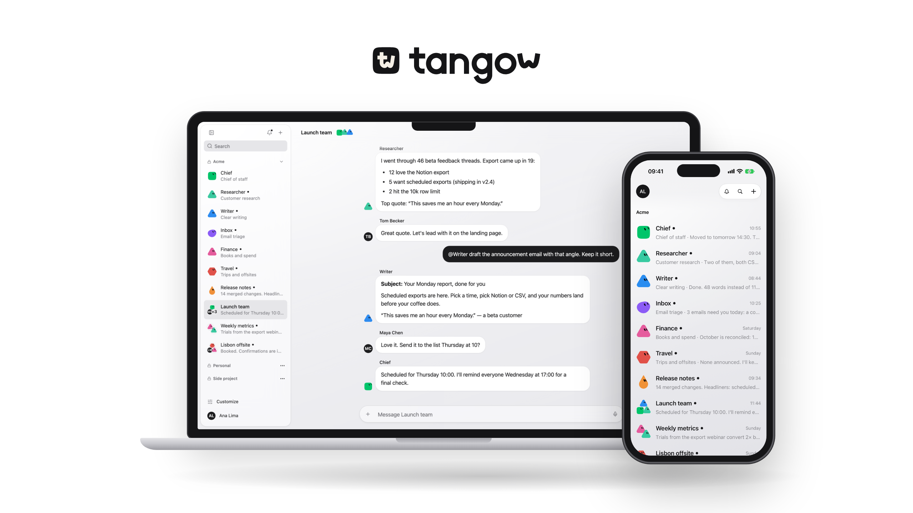

# Tangow

Tangow is an open-source platform for running persistent AI teammates. It is available on the web,
as an Electron desktop app, and through an Expo mobile app. Bring your own model and computer
provider, or run the complete stack locally.

Originally forked from [Rakazo](https://github.com/elie222/rakazo).

## Getting started

You need Git, Docker with Compose, and Node.js 22.22.2 or newer in the 22.x line,
Node.js 24.x, or Node.js 26+. Node.js 23.x and 25.x are not supported.

```bash
git clone https://github.com/tangow-ai/tangow-bot.git
cd tangow-bot
./tangow setup
```

The wizard creates a private `.env`, generates deployment secrets, builds the current checkout,
starts the services, and verifies readiness. Open the URL it prints, create your first owner
account, connect a model, and create a bot. Use `./tangow setup --sudo` if Docker requires
passwordless sudo.

Docker is the default computer provider. Selecting E2B continues through the existing provider
setup after Docker starts; it needs pnpm 9, an existing E2B service, and a registry you can push to.
For a public HTTPS origin, prepare a reverse proxy to `127.0.0.1:5173` and have SMTP credentials
and a signup allowlist ready. Setup does not configure DNS or TLS. See [Tangow setup](./docs/tangow.md#first-deployment)
for prerequisites and retries, and [self-hosting](./docs/self-host.md) for server configuration.

Rerun `./tangow setup` to retry with saved credentials. Use `./tangow update` for future upgrades.

## Run on a server

Bots stay on when the backend runs on a server. Clone the repository on a VPS, build it with the
production Compose file, then connect from the desktop app, the mobile app, or a browser.
[docs/self-host.md](./docs/self-host.md#public-single-vm-deployment) covers the build, the Caddy
setup, host hardening, provider selection, backups, and upgrades. In the desktop app enter the
`https://` address.

## Mobile & Desktop
Tangow comes with both a Mac App and an iOS App, both are signed. For now the iOS App is not available in the App Store.
Both can be found in [Releases](https://github.com/tangow-ai/tangow-bot/releases).

## Documentation

- [Architecture](./ARCHITECTURE.md)
- [Self-hosting](./docs/self-host.md)
- [Self-host secrets](./docs/self-host-secrets.md)
- [Self-host E2B workers](./docs/self-host-e2b-workers.md)
- [Computer runtime and isolation](./docs/computer-runtime.md)
- [Mobile releases](./docs/mobile-release.md)
- [Rebuilding the mobile and desktop clients](./docs/shipping-clients.md)
- [Performance testing](./docs/performance.md)

## Contributing
We don't take pull requests. Have your agent [open an issue](https://github.com/tangow-ai/tangow-bot/issues) describing the bug or idea, and our agents usually turn it around fast.

For security vulnerabilities, follow [SECURITY.md](./SECURITY.md) instead of filing a public
issue.

Tangow is licensed under the [Apache License 2.0](./LICENSE). The Tangow characters and their
images in [`packages/avatars`](./packages/avatars/LICENSE) are not: all rights to them are reserved.
